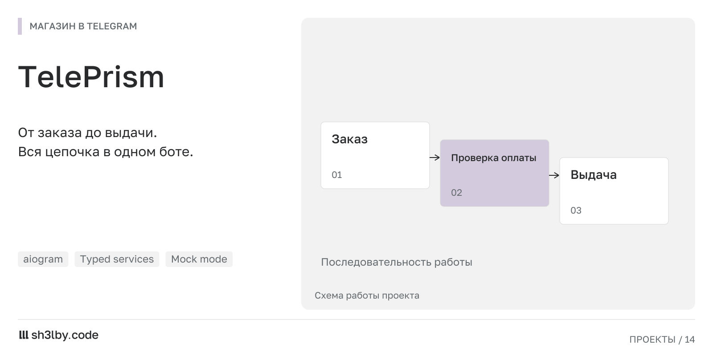

# TelePrism

<!-- portfolio-card:start -->
[](docs/portfolio/card.svg)
<!-- portfolio-card:end -->

Покупатель выбирает товар, получает реквизиты и ждёт выдачи. Менеджер видит оплаченный заказ в своей очереди и отмечает выполнение. TelePrism связывает эти шаги внутри Telegram; пример каталога построен на пакетах Telegram Stars.

Основная задача проекта находится между выставленным счётом и выдачей товара. Сумма может прийти частично, с переплатой или после срока ожидания. Для этих случаев предусмотрены отдельные состояния платежа и дальнейшая обработка.

## Как устроен путь заказа

CryptAPI-провайдер обслуживает USDT TRC20, а poller проверяет поступления. После подтверждения заказ получает менеджер; для выдачи предусмотрены SLA-таймеры. Уведомления проходят через outbox, SQLite-база резервируется отдельным воркером.

**Демонстрация:** `PAYMENTS_PROVIDER=mock` выдаёт вымышленный адрес и имитирует оплату через заданное время. Этот режим не обращается к блокчейну. Реальная интеграция подключается отдельно; запуск mock не подтверждает её работоспособность.

Приложение работает одним long-polling процессом. HTTP-сервер, Redis и Mini App для этого сценария не требуются. В репозитории настроены strict mypy, ruff, black и тесты.

Обсудить похожий проект: [sh3l.beer](https://sh3l.beer).

## Жизненный цикл заказа

```
/start → package or custom amount → order (DRAFT)
      → confirm → provider.create_address → AWAITING_PAYMENT, QR + address
      → poller: provider.logs every 10–120 s → WAITING / DETECTED / PARTIALLY_PAID / CONFIRMED / OVERPAID / LATE_PAID / EXPIRED
      → CONFIRMED → manager chat gets the order → manager marks delivered (proof optional) → buyer notified
```

## Платёжные провайдеры

| `PAYMENTS_PROVIDER` | Поведение |
|---|---|
| `cryptapi` | USDT TRC20 через [CryptAPI](https://cryptapi.io); задайте адрес своего кошелька получателя в `CRYPTAPI_WALLET_ADDRESS` |
| `mock` | Вымышленный адрес и имитация полной оплаты через `MOCK_CONFIRM_SECONDS`, без обращения к блокчейну |

Оба провайдера реализуют `integrations/base.py:PaymentProvider` с методами `callback_url`, `create_address`, `logs`. Сервисы зависят от этого протокола.

## Запуск

```bash
cp example.env .env      # BOT_TOKEN, OWNER_IDS, MANAGER_CHAT_ID, PAYMENTS_PROVIDER
uv sync
uv run teleprism
```

Через Docker: `docker compose up -d --build`. SQLite хранится в `./data`, срок хранения резервных копий задаёт `BACKUP_RETENTION_DAYS`.

## Проверки

```bash
uv run ruff check . && uv run black --check . && uv run mypy teleprism && uv run pytest
```

## Структура проекта

```
teleprism/app/
  bot.py, bootstrap.py, container.py, config.py   entry point, wiring, DI, settings
  handlers/, keyboards/, presenters/  user, manager, owner flows (aiogram 3 + Raito hot reload)
  services/                           checkout, payment, pricing, order, manager, support, notifications, audit
  repositories/                       SQLite access
  integrations/base.py                PaymentProvider protocol
  integrations/cryptapi/              client, provider, typed schemas, log parser
  integrations/mock/                  demo provider
  workers/                            payment poller, outbox, backups
  db/                                 connection, migrations
docs/TECHTASK.md                      original spec (RU)
```

## Лицензия

MIT
